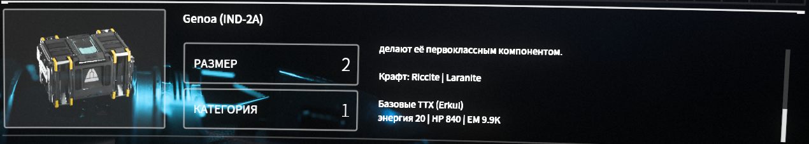

# SC Mod Launcher

Лаунчер для установки RuSC и безопасных подсказок Star Citizen через файл `global.ini`.

Лаунчер не меняет архивы игры, не трогает память, не ставит оверлеи и перед применением делает backup.

## Как установить

1. Скачайте релизный архив `SC_Mod_Launcher_*.zip`.
2. Откройте архив и извлеките из него папку `SC_Mod_Launcher` в удобное место.
3. Запускайте `SC_Mod_Launcher.exe` из этой папки.
4. Если Windows создала внешнюю папку с номером версии, не используйте её как рабочее имя установки. Рабочая папка должна быть именно `SC_Mod_Launcher`.

## Первый запуск

1. Укажите путь к папке `StarCitizen\LIVE`.
2. Откройте вкладку `Русификатор`.
3. Установите или обновите RuSC.
4. Если RuSC уже был установлен вручную или старой версией лаунчера, лучше сначала удалить его через лаунчер и затем установить заново.
5. Нажмите `Проверить`.
6. Если лаунчер просит обновить cache, нажмите `Прогреть кэш`.
7. Выберите нужные модули и галки.
8. Нажмите `Применить в LIVE`.

## Что включают модули

`Майнинг и крафт` добавляет подсказки по ресурсам, крафту, переработке, скупке руды и ТТХ предметов.

Внизу описаний Yela и Terminus отдельно показаны ресурсы астероидного пояса и подходящие крафт-подсказки по выбранным галкам. Ресурсы поверхности и пояса не смешиваются.

`Квесты и рецепты` добавляет чертежи, репутацию, метки контрактов, очки RSI Discovery Month, подсветку выгодных фарм-квестов и Wikelo-подсказки.

«Подсветка фарм-квестов» выделяет синим сценарии #5–7 и засады, где нужно укрыться в облаке и дождаться корабля, с наградой от 8 Council Scrip / MG Scrip. Для SC 4.10.2 это по три уровня (8, 12 и 16 скриптов) у Headhunters, Eckhart Security и Foxwell Enforcement; патрули и другие типы контрактов в список не входят.

Очки RSI Discovery Month автоматически подписываются в начале описаний контрактов: количество и категория события. Одинаковые очки общего зачёта не дублируются; отличающийся или единственный общий зачёт сохраняется. Отдельной галки нет, пороги и сведения о группе не добавляются; после исчезновения данных события подписи удаляются при повторном применении, отсутствующие задания пропускаются.

Семейства чертежей выбираются отдельно для майнинга и квестов. Чтобы видеть награды Рекко Баттальи, выберите нужное оборудование во вкладке квестов; там есть кнопка переноса выбора из майнинга. Скребковые модули находятся в группе «Модули утилизации».

Квесты, рецепты изготовления и классификация чертежей используют SCMDB. Для SC 4.10.2 доступны полные рецепты Monolith Shadowflux и F55 Shadowflux. Привычная структура фильтров сохранена; варианты объединяются по ресурсам, сохранённый выбор переносится. Бонусы переработки и цены руды берутся из UEX, базовые ТТХ — из Star Citizen Wiki. Журнал указывает фактическую версию источника и `FALLBACK`: ТТХ могут относиться к предыдущей версии. Числа репутации показываются только при наличии награды в источнике.

Каждый новый релиз включает заново прогретый кэш всех используемых источников. Сборка пакета проверяет успешность обновления SCMDB, UEX и Wiki; при fallback или непрогретом файле выпуск пакета останавливается.

Если у рецепта отсутствует название или карточка продукта, проверка кэша и отчёт применения перечисляют нерешённые записи. Количество загруженных рецептов не означает полное покрытие фильтров. Проверенные исправления названий учитываются отдельно.

Для Javelin S4 Cooler, радара Idris TEMP S3 и радара Polaris S4 доступны отдельные фильтры ресурсов с пометкой «без игрового имени». Это технические обозначения подтверждённых компонентов A; официальные названия и описания предметов ими не подменяются. Lephari относится к категории C и исключён общим правилом компонентов A; Pioneer пока исключён из-за отсутствующей карточки и неподтверждённой категории.

Скины и варианты одного предмета объединяются в одну строку при одинаковом наборе ресурсов; разные квесты не разделяют их. F55 и Monolith включают Shadowflux в общих группах. GT-210/215/220 объединены; Thlilye Laser Gatling относится к энергетике. Выбор из прежних отдельных групп и исправленных дублей с `Â` сохраняется при загрузке настроек.

## Как обновлять

На вкладке обновлений лаунчер проверяет GitHub Releases и ищет архив `SC_Mod_Launcher_*.zip`.

Если обновление найдено, используйте кнопку обновления в лаунчере. Пользовательские `config`, `backups` и backup обновления сохраняются.

После обновления примените выбранные модули заново. При применении также актуализируется номер SC Mod Launcher в меню игры; указанная версия RuSC сохраняется. Проверка обновлений сама не меняет `global.ini`.

Если обновление из старой версии не скачивается, загрузите ZIP последнего релиза вручную и извлеките из него папку `SC_Mod_Launcher`.

## Как откатиться

Откройте вкладку `Backup`.

Можно восстановить последний backup `global.ini` или выбрать нужный файл вручную. Перед откатом лаунчер дополнительно сохранит текущее состояние LIVE.

## Если GitHub не открывается

Если не открывается `api.github.com`, RuSC можно скачать вручную как ZIP со страницы StarCitizenRu и установить кнопкой `Из ZIP` на вкладке `Русификатор`.

## Лицензия и статус проекта

Исходный код SC Mod Launcher распространяется по лицензии `GPL-3.0-only`: его можно изучать и изменять, а при распространении изменённых версий нужно сохранить лицензию и предоставить соответствующий исходный код.

Логотип и оформление SCM, игровые скриншоты, RuSC и кэши сторонних сервисов в GPL не входят. Подробности: [LICENSE-SCOPE.md](LICENSE-SCOPE.md), [BRANDING.md](BRANDING.md), [THIRD_PARTY_NOTICES.md](THIRD_PARTY_NOTICES.md) и [SOURCE.md](SOURCE.md).

This is an unofficial Star Citizen fan project, not affiliated with the Cloud Imperium group of companies. All content not authored by the project is property of its respective owners. [Official Star Citizen website](https://robertsspaceindustries.com/).

## Как выглядит в игре

### Майнинг и переработка

### Подсказки предметов

Исторические примеры оформления; текущий источник ТТХ — Star Citizen Wiki.

